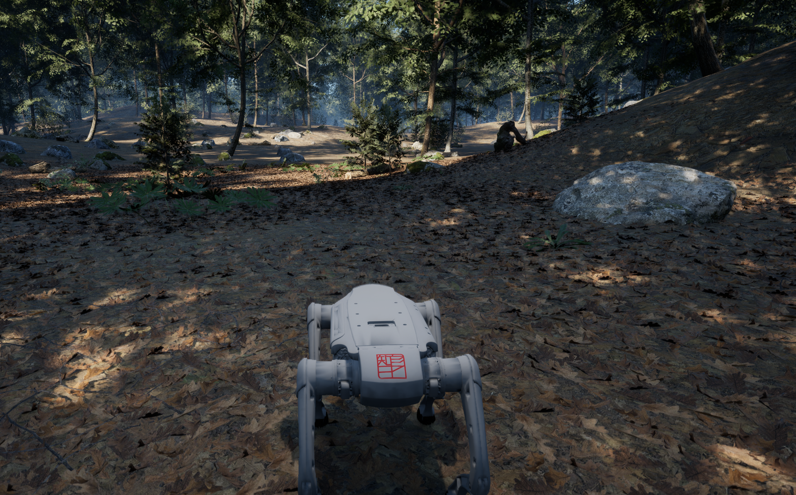
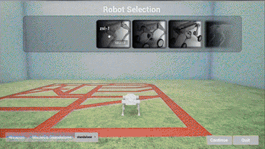
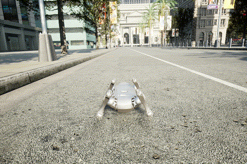
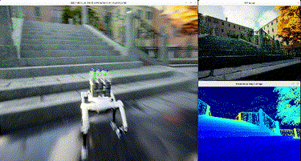
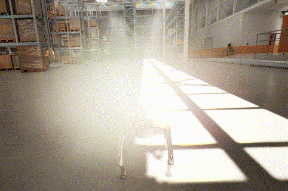
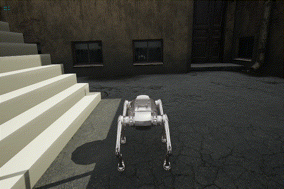

<div align="center">

<p><strong>English</strong> | <a href="docs/README_CN.md">Simplified Chinese</a></p>

# MATRiX

**A High-Fidelity Robot Simulation Platform Powered by Unreal Engine and MuJoCo**



[Why MATRiX](#why-matrix) · [Promotional Demo](#-promotional-demo) · [Quick Start](#-quick-start) · [Documentation](#-documentation) · [Robots & Maps](docs/Robots_and_Maps.md)

</div>

MATRiX is a runtime-first robot simulation platform that combines Unreal Engine 5 rendering with MuJoCo dynamics in one workflow. Load an MJCF/XML robot directly, assemble a calibrated sensor suite, run built-in motion control, and stream ROS 2-compatible data over Zenoh—without installing ROS 2 for the core simulator.

> [!IMPORTANT]
> The current release is **v1.1.2** and provides a Linux x86_64 runtime. Install a suitable graphics driver before running it; the simulator is not limited to Ubuntu 22.04. Requirements of optional external controllers depend on the separately downloaded version.

## Why MATRiX

| From model to algorithm | What MATRiX provides |
|---|---|
| **Bring up robots faster** | Load MJCF/XML at runtime and configure robots, initial poses, sensors, topics, and control mode through JSON instead of rebuilding the simulator for every model. |
| **Test perception with sensor realism** | RGB, semantic ground truth, infrared, GPU depth, panorama, fisheye, generic LiDAR, Mid360, Airy, IMU, GPS, and odometry; camera calibration, Brown-Conrady and Kannala-Brandt distortion, LiDAR scan timing, and motion distortion are modeled in the simulation path. |
| **Keep multi-sensor data coherent** | A unified ROS 2 time model supports stable UTC, Unreal simulation time, external `/clock`, and fixed-step time. Camera and LiDAR can share hardware-style trigger groups and timestamps. |
| **Move from simulation control to controller integration** | MuJoCo runs on a dedicated worker with a 500 Hz target. Built-in motion control is enabled by default (`inside_mc=true`), while the optional external `robot_mc` uses the same simulated-hardware ABI; joint and actuator targets are constrained by the active MuJoCo model. |
| **Use ROS-compatible data without a ROS dependency** | Zenoh publishes ROS 2-compatible CDR messages such as compressed images and `PointCloud2`. The simulator can run standalone, while ROS 2 bridges remain optional. |
| **Scale scenes independently from the base runtime** | The launcher updates a validated remote map catalog, detects mounted content, and downloads map DLCs on demand. Standard UE scenes, dynamic actors, Gaussian-splatting content, and Pixel Streaming 2 can share the same runtime. |
| **Debug with tools already in the release** | Sensor receiver, topic monitor, LiDAR-camera projection, categorized XY bounding boxes, fisheye projection, recording/replay, gimbal control, motion-control UDP tests, spawn tests, and voice-message tests are included under `Tools/`. |

## 🎥 Promotional Demo

<div align="center">
  
  <p>
    <strong>MATRiX 2.0 Simulation Showcase</strong><br/>
    <sub>Robot selection · High-fidelity environments · Multi-robot simulation · Reinforcement learning · Real-world scene reconstruction</sub>
  </p>
</div>

## ✨ Core Capabilities

- **Runtime robot onboarding:** MJCF/XML loading, custom models, visual/collision binding, and reusable sensor schemes without baking every robot into a separate package.
- **High-rate physics and control:** Dedicated MuJoCo simulation worker, 500 Hz target control/hardware loops, command timeout handling, and model-derived joint/actuator limit enforcement.
- **Calibrated perception:** GPU scene depth, asynchronous GPU readback and encoding, perspective and fisheye lens models, synchronized capture, and LiDAR per-point timing/motion-distortion support.
- **Open data plane:** Zenoh publish/subscribe with ROS 2-compatible message layouts, configurable key expressions, unified timestamps, and optional LAN state/event synchronization.
- **Flexible control architecture:** Built-in motion control for a ready-to-run experience, or a separately downloaded external controller through the original shared-memory hardware interface—selected with one configuration switch.
- **Expandable environments:** Dynamic map catalog updates, automatic DLC download and mounting, runtime map detection, Gaussian-splatting rendering, crowds/vehicles, and Pixel Streaming 2.
- **Developer-facing workflow:** JSON and graphical sensor configuration plus Linux tools for data inspection, projection, bounding boxes, gimbal control, and protocol testing.

### Built for

- Perception, SLAM, sensor-fusion, and synthetic-data development.
- Locomotion, whole-body control, reinforcement learning, and controller regression.
- Simulated-hardware and external-controller integration before physical-robot deployment.
- Multi-scene testing, remote demonstrations, and browser-based visualization.

## 🎬 Simulation Gallery

<div align="center">
<table>
<tr>
<td align="center"><br/><sub>Town10 · Urban Robot Navigation</sub></td>
<td align="center"><br/><sub>Venice · RGB and Sensor Visualization</sub></td>
</tr>
<tr>
<td align="center"><br/><sub>Warehouse · Industrial Lighting and Scale</sub></td>
<td align="center"><br/><sub>Courtyard · Locomotion Near Steps</sub></td>
</tr>
</table>
</div>

## 🚀 Quick Start

1. Download MATRiX v1.1.2:
   - [Direct Linux download](http://39.96.31.125:18080/matrix/v1.1.2/Linux/MATRiX_v1.1.2.tar.gz): complete `.tar.gz`, supports resume.
   - [GitHub Release](https://github.com/zsibot/matrix/releases/tag/v1.1.2): download **all** `.part-*` assets and `SHA256SUMS`. Each part is below 2 GB.
   - [Baidu Netdisk](https://pan.baidu.com/s/1dweDOFO5AzRmzY1-gEI53Q), code `118g`: **select the latest Linux version** (this guide targets v1.1.2).
2. Extract the complete archive, or verify and extract the GitHub parts:

```bash
# Direct/Baidu complete archive
tar -xzf MATRiX_v1.1.2.tar.gz
# GitHub parts: use this instead, in a directory containing only this release's parts
sha256sum -c SHA256SUMS && \
  cat MATRiX_v1.1.2.tar.gz.part-* | tar -xzf -
```

3. Start the runtime:

```bash
cd MATRiX_v1.1.2
./UeSim.sh
```

This Git repository contains documentation, Python tools and release scripts; the executable runtime, Engine and models are distributed as download assets. Cloning the repository does not install the simulator. See [download and checksum instructions](docs/Release_Download.md).

Defaults are `xgb`, `inside_mc=true`, and `sensor_sync_mode=true`. The initial `robot.sensors` dictionary is empty, so sensors do not publish automatically. `sensor_sync_mode=true` is retained. Load and apply `config_default.json` (IMU, odometry, GPS, RGB, depth, Airy), or another scheme, before entering the simulation and spawning the robot. See [sensor schemes](docs/Sensor_Schemes.md).

Built-in motion control requires no external process. Optional standalone `robot_mc` remains a [separate download](https://github.com/GENISOM-AI/MATRiX_Robot_MC/releases); follow the [motion-control guide](docs/Motion_Control.md).

In map selection, select **UPDATE LIST**, then **DOWNLOAD** for the required map. For manual DLC downloads, use [Baidu Netdisk](https://pan.baidu.com/s/1I87hQ9C8XzIGXgbyWk3i9A?pwd=6sth#list/path=%2F), code `6sth`; select the latest DLC compatible with your runtime. See [map DLCs](docs/Map_DLC.md).

Optional Python tools (Python 3.10+) run from the extracted runtime directory:

```bash
python3 -m venv .venv
. .venv/bin/activate
python3 -m pip install -r Tools/requirements.txt
python3 Tools/zenoh_sensor_receiver.py --key 'rt/**'
```

See [Getting Started](docs/Getting_Started.md) and the [tool index](Tools/README.md).

## 📚 Documentation

| Topic | Documentation |
|---|---|
| Installation and startup | [English](docs/Getting_Started.md) · [Chinese](docs/Getting_Started_CN.md) |
| Release download and checksums | [English](docs/Release_Download.md) · [Chinese](docs/Release_Download_CN.md) |
| Robots and environments | [English](docs/Robots_and_Maps.md) · [Chinese](docs/Robots_and_Maps_CN.md) |
| Maps and DLCs | [English](docs/Map_DLC.md) · [Chinese](docs/Map_DLC_CN.md) |
| Sensors and Zenoh | [Sensor and Communication (Chinese)](docs/Sensor_and_Communication_CN.md) |
| Sensor configuration | [Sensor Configuration Tutorial](docs/Sensor_Config_Tutorial.md) |
| Data tools | [Python Tools (Chinese)](docs/Python_Tools_CN.md) |
| LiDAR-camera projection | [English](docs/Lidar_Camera_Projection.md) · [Chinese](docs/Lidar_Camera_Projection_CN.md) |
| Motion control | [English](docs/Motion_Control.md) · [Chinese](docs/Motion_Control_CN.md) |
| Controllers | [Controller Guide](docs/Controller_Guide.md) · [Chinese](docs/Controller_Guide_CN.md) |
| Manual configuration | [Advanced Configuration (Chinese)](docs/Advanced_Configuration_CN.md) |
| Architecture and maintenance | [Maintainer Guide](docs/MAINTAINER_GUIDE.md) |
| Troubleshooting | [FAQ (Chinese)](docs/FAQ_CN.md) |
| Docker | [Docker Support Status](docs/Docker_Tutorial.md) |
| Pixel Streaming | [Pixel Streaming Guide](docs/pixelstreaming_tutorial.md) |
| Sensor schemes and GPU LiDAR | [English](docs/Sensor_Schemes.md) · [中文](docs/Sensor_Schemes_CN.md) |
| Fisheye projection and recording | [Fisheye (Chinese)](docs/Lidar_Fisheye_Projection_CN.md) · [Recording (Chinese)](docs/Zenoh_Recording_CN.md) |
| Release changes | [v1.1.2 Release Notes (Chinese)](docs/Release_Notes_CN.md) |
| Chinese documentation index | [Simplified Chinese](docs/README_CN.md) |

## 💬 Community

**Add the GENISOM AI WeChat assistant for MATRiX simulation discussions and support:**

<div align="center">
  
  <p><em>Scan to add XinQi Robo; mention MATRiX to join the simulation community.</em></p>
</div>

## 🤝 Contributing

Bug reports, documentation improvements, and runtime tooling changes are
welcome. Start with [CONTRIBUTING.md](CONTRIBUTING.md), and review the
[architecture and maintainer guide](docs/MAINTAINER_GUIDE.md) before changing
launch or release scripts. Security issues should follow [SECURITY.md](SECURITY.md)
rather than being filed as public issues.

## 🙏 Acknowledgements

This project builds upon the incredible work of the following open-source projects:

- [MuJoCo-Unreal-Engine-Plugin](https://github.com/oneclicklabs/MuJoCo-Unreal-Engine-Plugin)
- [MuJoCo](https://github.com/google-deepmind/mujoco)
- [Unreal Engine](https://github.com/EpicGames/UnrealEngine)
- [CARLA](https://carla.org/)

For semantic/RGB pairing, class IDs and display, see [Semantic camera / 语义相机](docs/Semantic_Camera.md)。

XXG is hidden in open-source mode. The defaults are `xgb`, built-in motion control enabled, and no active sensors.

Mirrors synchronize independently. If this version is not available there, use GitHub Release; select the latest version on Baidu Netdisk.

The open-source runtime excludes `UeSim/Content/model/xxg`.
